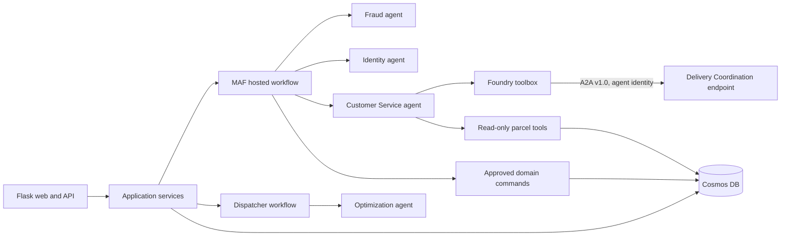

# Agent-to-Agent (A2A) Design Review

**Status:** Conditional go for a bounded pilot; no blanket migration  
**Reviewed:** 2026-09-17  
**Scope:** Zava's nine-agent runtime, orchestration, deployment, identity, and test posture

## Executive decision

Zava should adopt Foundry Agent2Agent (A2A) v1.0 only at boundaries where a specialist agent is independently deployed, independently owned or versioned, and useful to more than one caller. Zava should not replace its current fraud and dispatcher workflows with A2A.

The immediate uplift should be to finish the migration from classic `beta.assistants` agents to Responses-based Foundry agents or hosted Microsoft Agent Framework (MAF) agents. A2A can follow as a small pilot. Adding A2A before that migration would add network hops, identity configuration, cost, and failure modes without removing the current application's orchestration responsibilities.

**Recommended first pilot:** Customer Service delegates a bounded, read-only delivery-exception investigation to an independently deployed Delivery Coordination agent. Keep parcel lookup as a local tool call and keep all status changes, parcel holds, notifications, and identity decisions under deterministic application or workflow control.

**Current implementation readiness:** No-go. The pilot is blocked until the first six gates below are complete.

| Readiness gate | Current state |
|---|---|
| `azure-ai-projects>=2.5.0` with reproducible dependency resolution | Not met |
| Responses-based, versioned Foundry target agent | Not met |
| Independently deployed target with incoming A2A enabled | Not met |
| Agent-scoped Foundry Agent Consumer assignment and `RemoteA2A` connection | Not met |
| Versioned request/response contracts and contract tests | Not met |
| Correlated traces, deadlines, retries, and fallback tests | Not met |

## What changed in Foundry

The September 2026 Foundry guidance makes A2A protocol v1.0 generally available:

- A Foundry agent can call a remote A2A endpoint through an `a2a` tool or a reusable toolbox.
- A Responses-based Foundry prompt agent can expose an authenticated A2A endpoint and agent card.
- Foundry-to-Foundry calls can use agent identity with audience `https://ai.azure.com`.
- The target can grant the least-privilege **Foundry Agent Consumer** role at agent scope.
- A2A is intended for lightweight delegation. MAF workflows remain the recommended option for multistep orchestration, branching, and human approval.

Relevant documentation:

- [Connect to an A2A agent endpoint](https://learn.microsoft.com/azure/foundry/agents/how-to/tools/agent-to-agent?pivots=python)
- [Enable incoming A2A on a Foundry agent](https://learn.microsoft.com/azure/foundry/agents/how-to/enable-agent-to-agent-endpoint)
- [Foundry workflow migration guidance](https://learn.microsoft.com/azure/foundry/agents/concepts/workflow#migration-guide)

## Current-state findings

### Runtime model

Zava currently has two agent execution paths behind `USE_MAF`:

1. The default path uses the Azure OpenAI Assistants preview API, `asst_*` identifiers, threads, polling, and local function dispatch in `src/infrastructure/agents/core/base.py`.
2. The MAF path creates ephemeral in-process `Agent` instances with `FoundryChatClient` or `OpenAIChatClient` in `src/infrastructure/agents/maf/client.py`.

The deployment script creates nine classic assistants through `client.beta.assistants.create`. These are not the new Responses-based Foundry agent versions required for incoming Foundry A2A.

The package floor is `azure-ai-projects>=1.0.0`; the A2A Python guidance requires `azure-ai-projects>=2.5.0`. The project has no lock file, so reproducible compatibility is not currently guaranteed.

### Orchestration model

Agents do not presently discover or call one another:

- `workflows/fraud_to_customer_service.py` owns fraud routing, notification, identity verification, and parcel-hold decisions.
- `src/infrastructure/agents/maf/workflows.py` owns the same fraud thresholds in its MAF path and invokes each agent directly.
- Dispatcher-to-Optimization is a two-step `SequentialBuilder` workflow.
- Web routes invoke specialist agents directly through `call_azure_agent`.

This is application-mediated orchestration. It is a good fit for auditable business rules, but it also means the Flask application knows every agent and transports untyped prompt text between them.

### Deployment model

`azure.yaml` defines one App Service named `web`; it has no `azure.ai.agent` services. `maf_agent_server.py` exposes only Customer Service and is described as a local Agent Inspector endpoint, not a deployed Foundry agent endpoint. Therefore, none of the MAF specialist agents currently has the independently addressable Foundry endpoint needed for an internal A2A topology.

### Test and operations gaps

- No focused tests were found for `run_fraud_workflow`, `run_dispatcher_workflow`, or the `USE_MAF` branch.
- The legacy path silently falls back when MAF invocation fails. That is useful during migration but can conceal production drift.
- Inter-agent payloads are free-form text; fraud risk parsing depends on regex rather than a versioned schema.
- A2A-specific authorization, timeout, retry, idempotency, trace correlation, and contract tests do not exist.
- `azd` is not installed in the reviewed environment, so deployed agent endpoints and connection configuration could not be inspected.

## Option assessment

| Option | Benefits | Costs and risks | Decision |
|---|---|---|---|
| Keep current application orchestration | Lowest change; explicit control; easy local debugging | Classic API debt; tight application coupling; duplicate workflow logic | Keep temporarily, modernize runtime |
| Convert every internal call to A2A | Standard protocol; independent deployment; reusable specialists | More latency/cost; distributed failure modes; no current independent endpoints; weaker fit for deterministic flows | Reject |
| Keep MAF workflows and add selective A2A boundaries | Preserves control while enabling independently owned specialists and cross-project reuse | Two interaction models to operate; needs contracts and tracing | Recommend |
| Move all orchestration to Foundry visual workflows | Less host code | Preview/retiring visual execution; hosted agents unsupported in designer | Reject |

## Flow-by-flow disposition

| Flow | Recommended mechanism | Reason |
|---|---|---|
| Fraud -> Identity -> Customer Service | MAF workflow plus deterministic policy code | Conditional, security-sensitive, auditable, and potentially human-in-the-loop |
| Dispatcher -> Optimization | MAF `SequentialBuilder` | Ordered multistep pipeline with shared run state |
| Customer Service -> parcel lookup | Local function/tool | Same application and data boundary; A2A adds no useful isolation |
| Customer Service -> delivery-exception specialist | A2A pilot | Bounded delegation can be independently deployed and reused |
| Parcel hold, identity result, delivery status mutation | Application command/service with approval and idempotency | Business side effects must not depend solely on agent-selected delegation |
| External carrier or partner agent | A2A when protocol-compatible | Standards-based cross-team boundary is A2A's strongest use case |

## Proposed target architecture



The application remains the system of record and policy enforcement point. MAF owns repeatable multistep workflows. A2A is used only for a caller-controlled handoff to a separately deployed specialist.

## Pilot design

### Boundary

Expose Delivery Coordination as a Responses-based Foundry agent with one skill in its agent card: investigate a delivery exception and return a recommendation. Customer Service receives the A2A tool through a versioned Foundry toolbox.

The pilot contract is text-only at the protocol boundary, but the content should be strict JSON:

```json
{
  "schema_version": "1.0",
  "correlation_id": "string",
  "tracking_number": "string",
  "exception_code": "string",
  "customer_question": "string"
}
```

The response must include `schema_version`, `correlation_id`, `summary`, `recommended_action`, `confidence`, and `evidence`. It must not mutate parcel state.

### Identity and authorization

- Use A2A v1.0 explicitly. Do not use `a2a_preview` or rely on the v0.3 default.
- Use the calling agent's identity with audience `https://ai.azure.com`.
- Grant **Foundry Agent Consumer** at the Delivery Coordination agent scope, not project scope.
- Store the target endpoint and authentication in a Foundry `RemoteA2A` connection.
- Prefer a toolbox to centralize connection reuse, versioning, and policy.
- Do not use anonymous or key authentication for a Foundry target; incoming Foundry A2A requires Microsoft Entra ID.

### Reliability and observability

- Apply an end-to-end deadline and bounded retry with jitter only for transient failures.
- Do not retry non-idempotent operations through A2A.
- Propagate a correlation ID in the payload and telemetry.
- Record caller agent/version, target agent/version, toolbox version, latency, outcome, token usage, and schema-validation result.
- Fail closed for authorization and schema errors; return a controlled Customer Service fallback for timeout or target unavailability.
- Treat A2A task/context retention of 60 days as service data retention and review it against Zava's privacy policy.

### Protocol constraints

Foundry A2A v1.0 is JSON-RPC, text-only, and non-streaming for incoming agent calls. Do not place the A2A hop directly in the chatbot's token-streaming path unless the UI can tolerate a buffered specialist response. Images, proof-of-delivery files, and other binary evidence must remain in governed storage and be referenced by approved metadata, not sent as A2A file payloads.

## Migration plan

### Phase 0: Baseline

1. Add focused tests for both MAF workflows and capture latency, success rate, token use, and output quality.
2. Replace regex-only inter-agent outputs with validated Pydantic contracts.
3. Make legacy fallback observable and configurable; do not silently mix execution planes in production.
4. Pin reproducible dependency versions and raise `azure-ai-projects` to at least 2.5.0 in an isolated branch.

### Phase 1: Modernize the agent runtime

1. Choose prompt-agent or hosted-agent deployment per specialist.
2. Replace classic `beta.assistants` provisioning and `asst_*` routing with versioned Foundry agents using the Responses protocol.
3. Model each deployable agent as an `azure.ai.agent` service or otherwise manage its immutable version and endpoint as infrastructure.
4. Deploy the fraud and dispatcher orchestrations as MAF hosted workflows; do not convert them to A2A chains.

### Phase 2: Run the A2A pilot

1. Deploy Delivery Coordination independently and enable its v1.0 agent card and incoming A2A endpoint.
2. Create the least-privilege role assignment and `RemoteA2A` connection.
3. Create a versioned A2A toolbox and attach it to Customer Service.
4. Route only the delivery-exception intent to A2A behind a feature flag.
5. Run shadow traffic before allowing the remote result to influence customer responses.

### Phase 3: Decide with evidence

Expand only if the pilot demonstrates independent reuse or ownership value. Remove the pilot if it only reproduces an in-process call with worse latency and cost.

## Acceptance criteria

The pilot is ready for production when all of the following are true:

- 100% of requests and responses pass the versioned contract.
- The target agent is callable only by its approved caller identity.
- A2A p95 added latency stays within the product's agreed budget.
- Timeout and 401/403/429/5xx paths produce tested, user-safe fallbacks.
- Duplicate requests cannot cause duplicate side effects.
- End-to-end traces correlate the web request, calling agent, toolbox, and target agent.
- A quality evaluation shows no regression against the in-process baseline.
- The team can independently deploy and roll back the target agent and toolbox version.

## Risks and mitigations

| Risk | Impact | Mitigation |
|---|---|---|
| Agent chooses the wrong delegation | Incorrect or unnecessary remote call | Narrow instructions, explicit intent gate, tool-choice tests |
| Added latency and model cost | Slower customer response | Bounded pilot, caching where valid, latency budget, retain local tools |
| Distributed partial failure | Incomplete workflow | Deadlines, controlled fallback, trace correlation, no remote side effects |
| Prompt or data over-sharing | Privacy exposure | Minimize payload, classify fields, redact logs, review 60-day retention |
| Contract drift | Runtime parsing failures | Versioned schema, consumer-driven contract tests, staged rollout |
| Excessive RBAC scope | Cross-agent access | Agent-scoped Foundry Agent Consumer role and periodic access review |
| SDK/platform churn | Deployment instability | Pin versions, use GA `a2a` v1.0, avoid preview CLI toolbox output |

## Final recommendation

Proceed with modernization and a selective A2A pilot, not a full A2A uplift. The target architecture should use:

- **MAF workflows** for fraud, dispatcher optimization, approvals, branching, and side effects.
- **Local tools/domain services** for same-process data access and commands.
- **A2A v1.0 through a Foundry toolbox** for independently deployed, reusable, text-based specialist delegation.

This approach gains standardized discovery, least-privilege agent identity, independent versioning, and future partner interoperability without surrendering deterministic control of Zava's operational workflows.