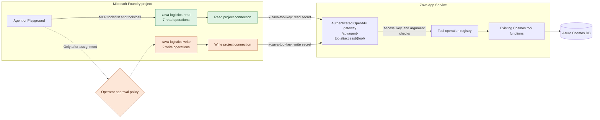

# Foundry Toolbox Design Decision

## Decision

**Status:** Implemented

Zava exposes its shared logistics operations through two versioned Microsoft Foundry toolboxes:

- `zava-logistics-read` contains seven non-mutating parcel, driver, dispatch, and performance operations.
- `zava-logistics-write` contains two mutating manifest and delivery-status operations.

The read and write surfaces use separate Foundry project connections and separate App Service secrets. The write toolbox is deliberately not attached to an agent until that agent has an explicit approval policy.

## Why We Needed a Toolbox

Zava already had Python functions that agents could call inside the Flask application. Those functions were useful for an in-process Microsoft Agent Framework runtime, but they were not a complete Foundry integration boundary:

1. Foundry cannot execute a Python function that exists only in the web application's process.
2. Registering the same function schema separately on every agent would duplicate configuration and allow those schemas to drift.
3. Read-only lookups and state-changing actions require different trust and approval boundaries.
4. Foundry Playground and other Foundry-hosted clients need a remotely callable protocol, not access to Zava's source tree or Cosmos DB credentials.
5. Tool contracts need independent versioning so agents can adopt or roll back a known operation set without redeploying the underlying business functions.

The Toolbox design converts the existing operations into reusable OpenAPI tools, exposes them through Foundry's MCP endpoint, and keeps database access inside the Zava application boundary.

## Design

The dashed write path is intentional. Publishing the write toolbox makes it reusable, but does not grant an agent permission to use it.

## Operation Boundaries

| Toolbox | Operations | Intended use |
|---|---|---|
| `zava-logistics-read` | `track_parcel`, `search_parcels_by_recipient`, `search_parcels_by_driver`, `get_delivery_statistics`, `get_pending_parcels_for_dispatch`, `get_available_drivers`, `get_performance_metrics` | Customer support, dispatch analysis, and operational reporting |
| `zava-logistics-write` | `create_manifest`, `update_delivery_status` | Controlled operational changes after explicit approval |

Both toolboxes call the same existing business functions used by the application. The gateway is an adapter, not a second implementation of parcel or manifest logic.

## Separate Read and Write Security Boundary

Read and write capabilities are separate security boundaries rather than labels on one combined tool surface.

- Each toolbox has its own `RemoteTool` project connection and API key.
- Foundry injects the appropriate key as the `x-zava-tool-key` header; agents do not receive the secret.
- The gateway fails closed when a key is missing, compares supplied keys in constant time, rejects tools outside the requested access class, and rejects missing or unexpected arguments.
- Cosmos DB credentials and data-plane access remain in App Service. Foundry calls the application API rather than Cosmos DB directly.
- A write operation still needs an agent-level human approval policy before the write toolbox is attached. Describing an operation as requiring approval does not enforce approval by itself.

The current keys authenticate a Foundry project connection, not an individual user. Per-user authorization and audit identity must be handled separately if future tools need user-scoped permissions.

## Tradeoffs of Using Toolbox

| Benefit | Cost or limitation |
|---|---|
| One reusable contract for multiple agents and Playground | Adds an HTTP and MCP hop to each tool call |
| Versioned tool collections can be adopted and rolled back independently | Toolbox versions and agent assignments require lifecycle management |
| Separate read and write capabilities support least privilege | Two connections and two secrets must be provisioned and rotated |
| Foundry stores connection authentication and injects headers | App Service availability becomes part of the agent tool path |
| OpenAPI makes operations discoverable and portable | The OpenAPI contract must stay synchronized with the Python implementation |
| Cosmos access stays behind the application boundary | Shared-key authentication does not provide end-user identity |
| Centralized tools reduce per-agent configuration drift | Foundry SDK and service changes can affect publishing or invocation |

These costs are acceptable because the gateway reuses the existing functions, the OpenAPI documents are generated from one operation registry, and read/write isolation limits the impact of a mistaken assignment.

## Tradeoffs of Not Using Toolbox

Without Toolbox, Zava would keep only local Agent Framework tools or register equivalent definitions independently on each agent.

| Without Toolbox | Consequence |
|---|---|
| Keep tools only as local Python callables | Foundry-hosted agents and Playground cannot invoke them directly |
| Duplicate tool definitions on each agent | Schemas, descriptions, and security settings can drift between agents |
| Give agents direct Cosmos DB access | Database credentials, query behavior, and data authorization spread outside the application boundary |
| Use one combined remote tool surface | Read-only agents can accidentally receive mutating capabilities |
| Couple tools to one runtime deployment | Reuse, independent versioning, and rollback become harder |
| Build bespoke HTTP calls into prompts or agent code | Tool discovery, typed arguments, and consistent invocation semantics are lost |

Not using Toolbox has lower initial platform complexity and avoids the extra network hop. It remains reasonable for a single local-only agent whose tools never need Foundry hosting, Playground access, reuse, or independent versioning. Zava no longer fits that case because it has multiple agents and shared operational capabilities.

## Deployment and Ownership

- The Flask gateway and OpenAPI generation live in `src/interfaces/web/routes/agent_tools.py`.
- `Scripts/create_foundry_toolboxes.ps1` provisions separate App Service keys and Foundry project connections.
- `Scripts/create_foundry_toolboxes.py` publishes new versions of the read and write toolboxes.
- The underlying implementations remain in `src/infrastructure/agents/tools/cosmos_tools.py`.

Publishing a new version does not automatically attach it to any agent. Agent assignment, write approval, and rollback remain explicit deployment decisions.

## Validation Criteria

The design is considered healthy when:

- Foundry lists seven read tools and two write tools.
- A read-only call succeeds through the Toolbox MCP endpoint and project connection.
- Requests with a missing or incorrect key fail.
- A read connection cannot invoke a write route.
- The write toolbox remains unattached until an approval policy is configured.
- No Cosmos DB credential is exposed to Foundry or an agent definition.
